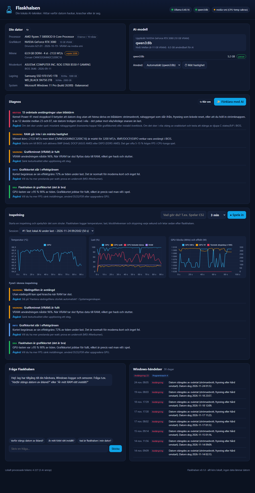
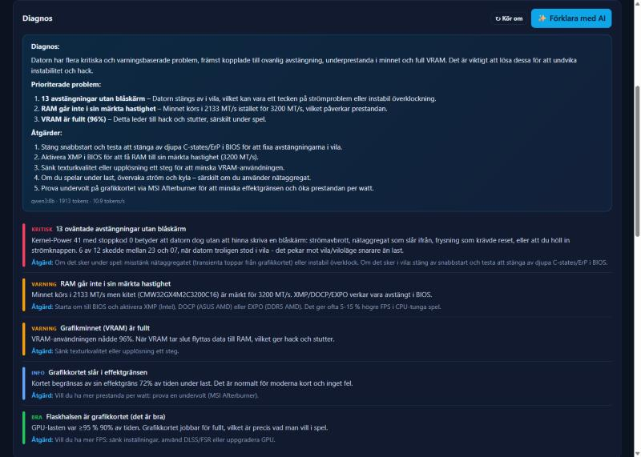
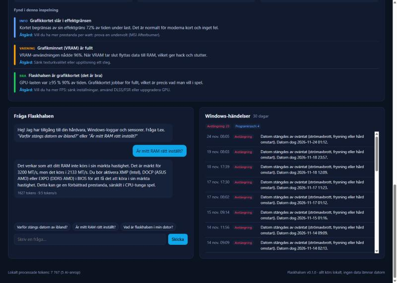

# Flaskhalsen

**En lokal AI-tekniker som hittar varför datorn hackar, kraschar eller är seg.**

Flaskhalsen läser av hårdvaran, Windows händelselogg och sensorerna (temperatur, last, klockor,
strypning). En regelmotor hittar konkreta fel, och sedan förklarar en lokal språkmodell dem på
svenska och svarar på följdfrågor. Allt körs på din egen dator: ingen data skickas någonstans.

Bidrag till SweClockers-tävlingen *"Gick inte. Nu går det."* (spår: Verktyget du alltid saknat).



## Vad den hittar

| Område | Exempel |
|---|---|
| Minne | XMP/DOCP/EXPO avstängt (läser märkt hastighet ur artikelnumret), single channel, blandade kit |
| Stabilitet | Oväntade avstängningar (Kernel-Power 41) med tidpunkt då datorn faktiskt dog, blåskärmar med förklarad stoppkod, WHEA-hårdvarufel |
| Grafikkort | Termisk strypning, effektgräns, hotspot-delta, PCIe x8 i stället för x16, drivrutinskrascher (TDR) |
| Flaskhals | CPU- eller GPU-bunden under spel, fullt VRAM, fullt RAM |
| System | Energisparläge, full disk, diskhälsa, varm NVMe-disk (strypning), avstängd växlingsfil, gamla drivrutiner/BIOS |

## Före / efter

Spara nuläget med **📸 Spara nuläget** innan du åtgärdar något (slår på XMP, byter kylpasta,
uppdaterar BIOS). Efteråt visar Flaskhalsen exakt vad som ändrats: lösta och nya fynd,
RAM-hastighet, temperaturer, ledigt diskutrymme, och antal krascher per vecka före och efter.
Krascher bedöms först efter ett dygn: noll krascher på två timmar bevisar ingenting.

## Be om hjälp i forumet

**📋 Kopiera till forumet** skapar en färdig rapport med dator, fynd, händelser och AI-sammanfattning,
i BBCode för SweClockers-forumet eller Markdown för Reddit/Discord. Inga serienummer följer med.

## AI-modellen anpassar sig efter datorn

Appen upptäcker grafikkort och **riktigt** VRAM (nvidia-smi, eller registret för AMD/Intel: WMI:s
`AdapterRAM` slutar på 4 GB) och väljer modellnivå ur [`config/models.json`](config/models.json):

| Användbart VRAM | Modell |
|---|---|
| < 5,5 GB / ingen GPU | `qwen3:4b` (körs på CPU vid behov) |
| 5,5–10,5 GB | `qwen3:8b` |
| 10,5–20 GB | `qwen3:14b` |
| 20 GB+ | `qwen3:30b` |

Den använder en installerad modell som passar, annars föreslår den en nedladdning med förloppsindikator.
Du kan alltid välja manuellt.

## Installera och kör

**Enklast:** ladda ner `Flaskhalsen-x.y.z.zip` under *Releases*, packa upp och dubbelklicka
`Flaskhalsen.cmd`. Python följer med, inget att installera. Hårdvarukoll och diagnos fungerar direkt.
Det finns också en enda `Flaskhalsen-x.y.z.exe` (ber om administratör), men den är inte signerad och
blockeras om Smart App Control är på. Endast Windows 10/11, inte Linux eller macOS.

- För AI-förklaringar och chatt behövs [Ollama](https://ollama.com/download). Saknas den visar
  AI-kortet knappen *Installera Ollama åt mig* (via winget), och sedan *Ladda ner* för modellen.
  Appen väljer modell efter ditt grafikkort.
- Valfritt: [LibreHardwareMonitor](https://github.com/LibreHardwareMonitor/LibreHardwareMonitor) som
  administratör med *Options → Remote Web Server* påslaget (port 8085) för CPU- och disktemperaturer.
  Utan det används nvidia-smi + psutil.

**Från källkod** (Python 3.11+): dubbelklicka `Starta Flaskhalsen.bat`, eller

```powershell
python -m venv .venv
.venv\Scripts\pip install -r requirements.txt
.venv\Scripts\python run.py
```

Öppna http://127.0.0.1:8765. Tester: `.venv\Scripts\python -m pytest`.
Bygg zip-paketet: `powershell -ExecutionPolicy Bypass -File build.ps1`.

## Hur den fungerar

```
hardware.py  ─┐
events.py    ─┼─► rules.py (deterministiska fynd) ─► llm.py (Ollama, svenska, verktygsanrop) ─► UI
sensors.py   ─┘         ▲
store.py (SQLite: inspelningar, tokens)
```

AI:n får aldrig gissa från råa siffror. Regelmotorn avgör *vad* som är fel, och modellen förklarar
*varför* och *vad man gör*. Den kan själv hämta mer data via verktyg (händelser, sensorer, systeminfo).

## Vad som gick fel på vägen

- **WMI ljuger om VRAM.** `Win32_VideoController.AdapterRAM` är ett 32-bitarsfält och visar max 4 GB.
  Lösning: nvidia-smi, och registervärdet `HardwareInformation.qwMemorySize` för AMD/Intel.
- **AI:n tog tio minuter att svara.** World of Warcraft var igång och tog grafikminnet. Med
  `num_ctx=8192` blev en prompt på 1 200 tokens aldrig klar på 3 minuter. Med 4096 tog en prompt på
  1 945 tokens 1,5 sekunder. Dessutom fortsätter Ollama generera efter att klienten gett upp, så nya
  frågor hamnade i kö bakom. Lösning: `num_ctx=4096`, tak på svarslängden (`num_predict`) och kompaktare verktygssvar.
- **8B-modellen ville inte anropa verktyg.** På frågan "Varför stängs datorn av?" ställde den motfrågor
  i stället för att läsa loggen. Lösning: sammanfattning och fynd läggs direkt i systemprompten, och
  verktygen används för detaljer.
- **Dubbla krascher.** Windows loggar både Kernel-Power 41 och EventLog 6008 för samma avstängning.
  6008 visade sig vara guld värt: den innehåller klockslaget då datorn *dog*, medan 41 bara visar när
  den startade igen.
- **Svensk Windows.** Sensorvärden som `45,0 °C` med decimalkomma, lokaliserade händelsetexter och
  osynliga LTR-tecken i datum i loggen.
- **Smart App Control stoppade exe-filen.** Första paketet byggdes med PyInstaller. Windows 11:s
  Smart App Control blockerade den direkt ("En programkontrollprincip har blockerat den här filen"),
  eftersom en nybyggd, osignerad exe saknar rykte. Det går inte ens att klicka "Kör ändå". Lösning:
  paketet innehåller i stället Pythons officiella embeddable-version (signerad av Python Software
  Foundation) och en `.cmd`-startfil. Ingen ny osignerad exe, och den startar fint med SAC påslaget.
  Exe-filen finns kvar som alternativ för den som har SAC avstängt. Att köra den som administratör
  hjälper inte, eftersom SAC stoppar filen innan den ens startar.
- **Webbläsaren körde gammal kod.** Efter en uppdatering syntes de nya knapparna men gjorde
  ingenting: sidan var ny men `app.js` kom från webbläsarens cache. Lösning: servern skickar
  `Cache-Control: no-cache`, så webbläsaren alltid frågar efter senaste versionen.
- **"0 krascher, bättre!"** Första versionen av före/efter-jämförelsen jublade direkt efter att
  man sparat, eftersom noll krascher på noll timmar ser ut som en förbättring. Nu väntar den ett dygn.
- **LibreHardwareMonitor** kräver drivrutinen PawnIO och administratörsrättigheter. Därför fungerar
  appen även utan den.

## Hårdvara och tokens (för tävlingen)

- Utvecklad och testad på: Ryzen 7 5800X3D, RTX 3080 10 GB, 64 GB DDR4, ASUS ROG STRIX B550-F.
- Lokalt: `qwen3:8b` via Ollama. Appen räknar själv alla lokalt processade tokens (visas längst ned i UI:t).
- Moln: koden skrevs med hjälp av Claude (Claude Code).

## Skärmdumpar

| AI-diagnos | Chatt |
|---|---|
|  |  |
